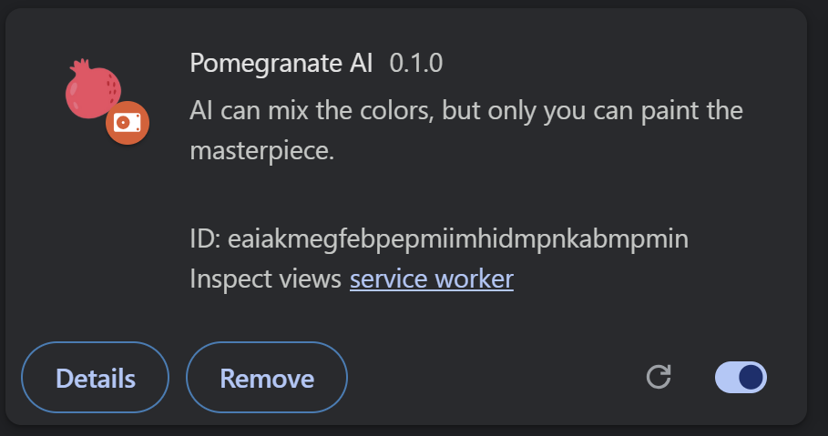
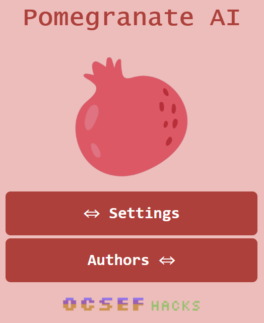
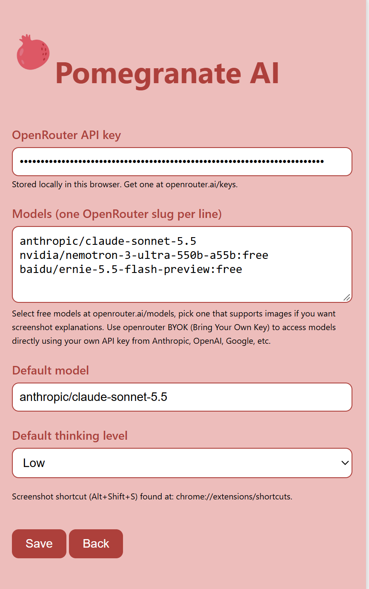
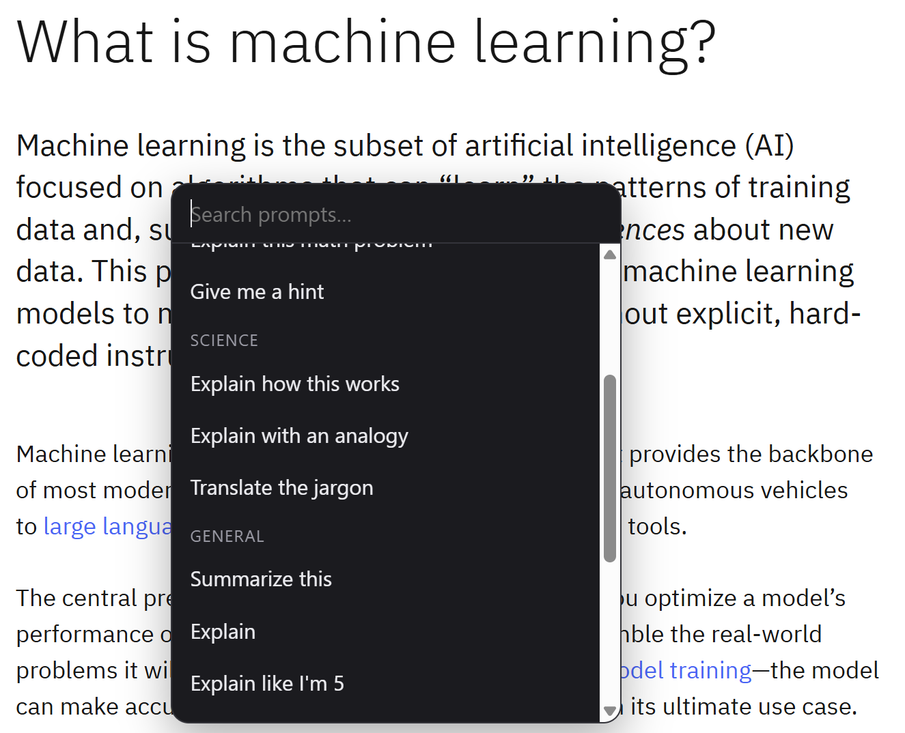

# pomegranate-ai

  

  

## AI can mix the colors, but only you can paint the masterpiece.

This project targets one of the 17 goals modeled by the United Nations, specifically goal 4 of quality education.

As we know, the rise of AI has benefitted us through greater efficiency in completing tasks, understanding concepts, and make our lives easier in general. Though, it has become a double edge sword, as people have used AI to outsource their thinking.

Pomegranate AI was developed to prioritize thinking first, and AI responses second. When Pomegranate is used, there are no prompts to write. All of the prompts are pre-made to ensure that AI solutions come second and learning is facilitated.

## Application

Pomegranate AI is an extension that sits in your side bar. Clicking the little icon leads you to the home page, where you can navigate to the authors page and settings page.

In settings, the API key and models can be configured there. The Chrome API handles all of the storage so when you save and leave, they will remain when you come back.

  

  

Example of the extension when chrome://extensions

  

  

if you click the pomegranate it will make a click sound

  

  

In the settings menu, the API key, models, thinking level, can all be configured

To use the AI, simply highlight or screenshot (Alt+Shift+S) to have the prompts appear. 

  

  

Little button popup that appears when highlighting

  

  

Not all of the different subjects are visible, there are enough to have to scroll!

  

  

Example of the screenshot function being used

  

  

Here, the explaination and follow up prompts are loaded here

## Nitty Gritty

OpenRouter is used as a middleground to connect Claude's API key to our program, and allow the program to send the premade prompts and recieve back the output.

OpenRouter also allows for multiple other models to be used as well. We currently use alongside Claude: 

* NVIDIA Nemotron 3 Ultra
* baidu ERNIE 5.5 Flash Preview

But OpenRouter is completely open to many, many other models. These are just the ones that we chose.

## Authors

Made with love ❤️❤️❤️❤️❤️ by

* Ethan P. Nguyen
* Jason Vo
* Le Phan
* Troung Anh Quan Pham

  

