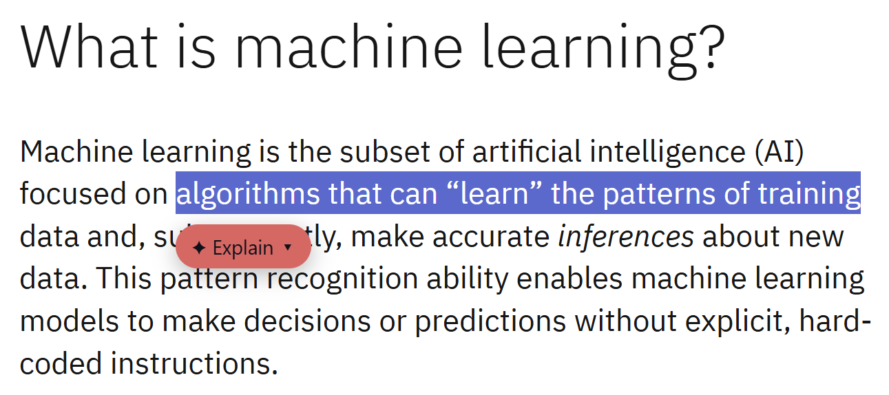
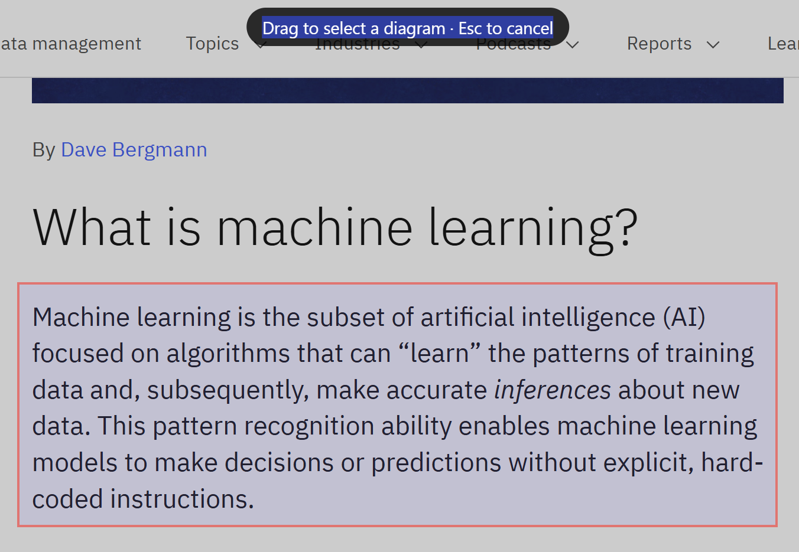
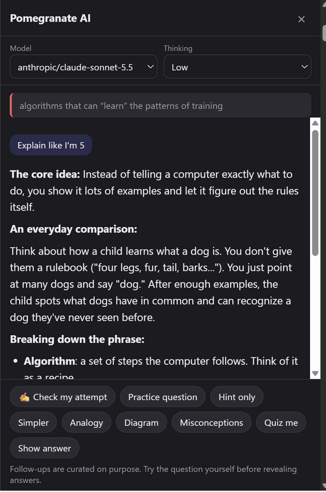

# pomegranate-ai

  

  

     

## AI can mix the colors, but only you can paint the masterpiece.

This project targets one of the 17 goals modeled by the United Nations, specifically goal #4 of quality education.

As we know, the rise of AI has benefited us through greater efficiency in completing tasks, understanding concepts, and making our lives easier in general. However, it has become a double-edged sword, as people have used AI to outsource their thinking.

Pomegranate AI was developed to prioritize thinking first, and AI responses second. When Pomegranate is used, there are no prompts you can enter. Our prompts are pre-made to ensure that AI works as a guide and learning is facilitated.

## Application

Pomegranate AI is an extension that sits in your sidebar. Clicking the little icon leads you to the home page, where you can navigate to the authors page and settings page.

In settings, the API key and models can be configured. The Chrome API handles all of the storage, so when you save and leave, everything will remain when you come back.

  

  

Example of the extension when on the page: chrome://extensions

  

  

When you press the pomegranate, it'll make a soothing keyboard sound!

  

  

In the settings menu, the API key, models, and thinking level, can all be configured

  

  

A little button popup that appears when highlighting text

  

  

You can't see it, but we've generated general prompts and subject-specific prompts; there's enough to scroll!

  

  

Here's an example of the screenshot function being used

  

  

The explaination and follow up prompts are loaded here

## Nitty Gritty

OpenRouter is used as a middle ground to connect Claude's API key to our program and allow the program to send the pre-made prompts and receive the output.

OpenRouter also allows for numerous other models to be used. Alongside Claude, we use: 

* NVIDIA Nemotron 3 Ultra
* Baidu ERNIE 5.5 Flash Preview

OpenRouter is completely open to many, many other models. These are just the ones that we found most suitable.

| **File** | **Purpose** | 
| :-- | :-- |
| `background.js` | Runs in background for OpenRouter and has event listeners for text highlighting & screenshotting |
| `content.js` | Script injected to show the explain button, screenshotter, and AI sidebar |
| `manifest.json` | Details of the extension read by the browser |
| `options.html` | The settings menu that stores API key, models, and thinking power |
| `options.js` | The settings menu that stores API key, models, and thinking power |
| `popup.css` | Source code for the popup on the sidebar |
| `popup.html` | Source code for the popup on the sidebar |
| `popup.js` | Source code for the popup on the sidebar |
| `prompts.js` | All of the AI prompts stored in variables |

## Authors

Made with love ❤️❤️❤️❤️❤️ by:

* Ethan P. Nguyen
* Jason Vo
* Le Phan
* Troung Anh Quan Pham

  

